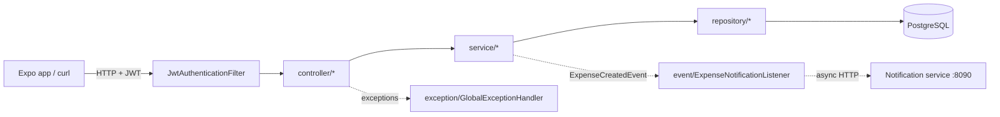
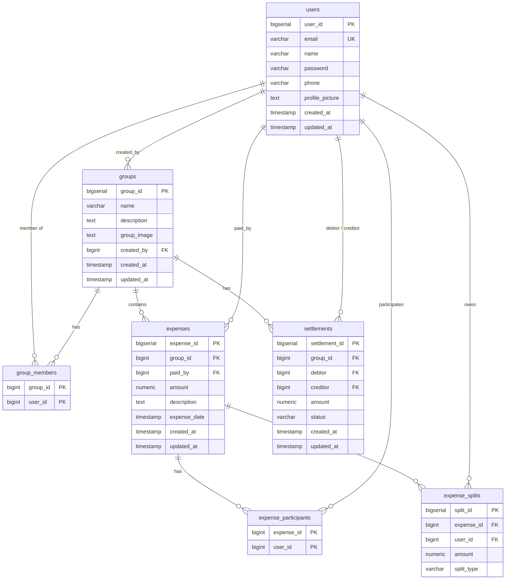
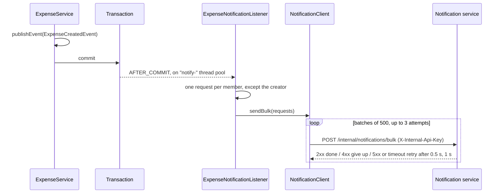

# Architecture

How the backend is put together: layers, what happens to a request, security, the data model, configuration and the notification side channel. For the business flows themselves, see [FLOWS.md](FLOWS.md).

## Layers



| Layer | Package | Responsibility |
|---|---|---|
| Security | `config/SecurityConfig`, `security/*` | Validates the JWT on every request and puts the user in the security context; rejects unauthenticated requests with 401 |
| Controllers | `controller/*` | Map HTTP to service calls, read the caller from `Authentication`, wrap results in `ApiResponse` |
| Services | `service/*` | All business rules: membership checks, split calculation, balances and settlements. `@Transactional` at class level |
| Repositories | `repository/*` | Spring Data JPA interfaces; two custom JPQL queries on `GroupRepository` |
| Entities | `model/*` | JPA entities mapped to the Liquibase-managed tables |
| DTOs | `dto/*` | Java records returned to clients (never entities, so passwords never leave the server) |
| Events | `event/*` | Decouples expense creation from notification delivery |
| Errors | `exception/*` | Turns exceptions into the standard JSON envelope and HTTP status |

### Services

| Service | Owns |
|---|---|
| `UserService` | Registration (duplicate-email check, BCrypt hashing), lookups, `UserDTO` mapping |
| `GroupService` | Create group, add member, `requireMember` / `isMember` access checks, `GroupDTO` mapping |
| `ExpenseService` | Create/read/delete expenses, validates payer and participants, triggers settlement regeneration, publishes `ExpenseCreatedEvent` |
| `SplitCalculatorService` | Equal split with cent-exact rounding; builds `ExpenseSplit` rows |
| `SettlementService` | Balance calculation, settlement regeneration, pending lists, marking paid |
| `NotificationClient` | HTTP client for the notification service (batching, retries) |

## Request lifecycle

Every request goes through the same path. Taking `GET /api/groups/7` as an example:

1. **CORS.** `SecurityConfig.corsConfigurationSource` allows origins `http://localhost:3000` and `http://localhost:8080`, methods `GET POST PUT DELETE OPTIONS`, any header, credentials allowed.
2. **JWT filter.** `JwtAuthenticationFilter` (a `OncePerRequestFilter` placed before `UsernamePasswordAuthenticationFilter`) reads `Authorization: Bearer <token>`. If the token's signature and expiry check out, it loads the user by the email in the token's `sub` claim and sets the authentication. Any problem is logged and the request simply continues unauthenticated.
3. **Authorization.** `/api/auth/**` is open; everything else requires authentication. An unauthenticated request stops here with `401 {"success":false,"message":"Authentication required","statusCode":401}`.
4. **Controller.** `GroupController.getGroup` casts `authentication.getPrincipal()` to `UserDetailsImpl` to get the caller's `userId`.
5. **Service.** `GroupService.requireMember(7, userId)` loads the group with members (`findByIdWithMembers`, a `LEFT JOIN FETCH`). Not found → `NotFoundException`; caller not a member → `ForbiddenException`.
6. **Response.** The controller maps the entity to `GroupDTO` and returns it wrapped in `ApiResponse`.
7. **Errors.** Any exception thrown in 4–6 is turned into a response by `GlobalExceptionHandler`.

Sessions are stateless (`SessionCreationPolicy.STATELESS`) and CSRF is disabled, since auth is a bearer token, not a cookie. `spring.jpa.open-in-view` is on (Spring's default), so lazy associations can still load while the controller builds DTOs.

## Response envelope and errors

Every response, success or error, has this shape (`dto/response/ApiResponse`); `null` fields are omitted (`jackson.default-property-inclusion: non_null`):

```json
{ "success": true, "message": "Group fetched successfully", "data": { ... }, "statusCode": 200 }
```

| Exception | Status | Typical cause |
|---|---|---|
| `MethodArgumentNotValidException` | 400 | Bean validation on a request record failed; `data` maps field → message |
| `NotFoundException` | 404 | Group, expense, settlement or user ID doesn't exist |
| `ForbiddenException` | 403 | Caller isn't a group member, isn't the payer (delete), or isn't a party to the settlement (pay) |
| `BadCredentialsException` | 401 | Wrong email or password at login |
| other `RuntimeException` | 400 | Business-rule violation, e.g. duplicate email, unsupported split type, non-member participant, settlement already paid |
| anything else | 500 | Unexpected; logged, message hidden (`"An unexpected error occurred"`) |

Two controllers still catch exceptions themselves: `AuthController.register` returns 400 for any failure, and `UserController` returns 400 (profile) or 404 (by ID).

## Security

- **Passwords** are hashed with `BCryptPasswordEncoder` on registration and checked by a `DaoAuthenticationProvider` at login.
- **Tokens** are HS512 JWTs signed with `jwt.secret` (needs at least 64 bytes). The subject is the user's email; expiry is `jwt.expiration` ms (default 24 h). There are no refresh tokens or roles; `UserDetailsImpl.getAuthorities()` is empty.
- **Object-level access** is enforced in services, not URL rules: `GroupService.requireMember` for anything group-scoped, a payer check for deleting an expense, and a debtor/creditor check for paying a settlement. See the access table in [API_DOCUMENTATION.md](../API_DOCUMENTATION.md#access-rules).

## Data model



- Money is `NUMERIC(19,2)` in the database and `BigDecimal` in Java.
- `Group.members` is the owning side of the many-to-many and is fetched eagerly; everything else is lazy.
- Deleting an expense removes its splits (JPA cascade) and participants (`ON DELETE CASCADE`).
- `settlements.status` is `PENDING` or `PAID`. Pending rows are disposable (regenerated on every expense change); paid rows are permanent history.
- `split_type` is always `EQUAL` today.
- Timestamps are written in UTC (`hibernate.jdbc.time_zone: UTC`) and converted back to the JVM's zone when read.

### Migrations

Liquibase runs `db/changelog/changelog-master.yml` on startup (`ddl-auto: none`, so Hibernate never changes the schema).

| Changeset | What |
|---|---|
| 001–007 | Create `users`, `groups`, `group_members`, `expenses`, `expense_participants`, `expense_splits`, `settlements` |
| 008 | `expenses.expense_date` from `DATE` to `TIMESTAMP` (the date was being truncated from a UTC timestamp, dating early-morning IST expenses to the previous day) |
| dml/001 | Five seed users; commented out in the master changelog |

To change the schema, add a new numbered SQL file under `P0/ddl/` with a `-- changeset` header and include it at the end of the master changelog. Never edit an applied changeset: Liquibase checksums it and will refuse to start.

## Configuration

`SplitwiseApplication.main` loads `.env` from the working directory into system properties before Spring starts (`EnvLoader` repeats this without overwriting, as a fallback). `application.yml` then reads them as placeholders, with defaults:

| Variable | Default | Used for |
|---|---|---|
| `DB_HOST`, `DB_PORT`, `DB_NAME` | `localhost`, `5432`, `splitwise_db` | JDBC URL |
| `DB_USERNAME`, `DB_PASSWORD` | `postgres`, `postgres` | Database login |
| `APP_PORT` | `8080` (`.env` sets `8088`) | HTTP port |
| `JWT_SECRET` | an insecure placeholder | Token signing; always set your own |
| `JWT_EXPIRATION` | `86400000` (24 h) | Token lifetime in ms |
| `NOTIFICATION_ENABLED` | `true` | Turn notification delivery on/off |
| `NOTIFICATION_BASE_URL` | `http://localhost:8090` | Notification service |
| `NOTIFICATION_INTERNAL_API_KEY` | none | Sent as `X-Internal-Api-Key` |

Logging: root `WARN`, `com.splitwise` `DEBUG` (settlement calculation logs every balance), Hibernate `INFO`.

## Notifications

Adding an expense notifies the other group members through a separate notification service, without ever affecting the expense request.



- `@TransactionalEventListener(AFTER_COMMIT)` means nothing is sent for an expense that rolled back; `@Async("notificationExecutor")` (2–4 threads, queue of 200, caller-runs when full) keeps the HTTP request fast.
- Each notification: `userId` = recipient's email (matches the JWT subject), `type` = `EXPENSE_ADDED`, `params` = `actorName`, `groupName`, `amount`, `expenseTitle` (description, max 100 chars), `referenceType` = `GROUP`, `referenceId` = group ID, `idempotencyKey` = `expense-<expenseId>-added-<userId>`.
- Timeouts: 2 s connect, 5 s read. Failures are logged and dropped; there is no outbox or later retry.
- With `NOTIFICATION_ENABLED=false`, `sendBulk` returns immediately.
