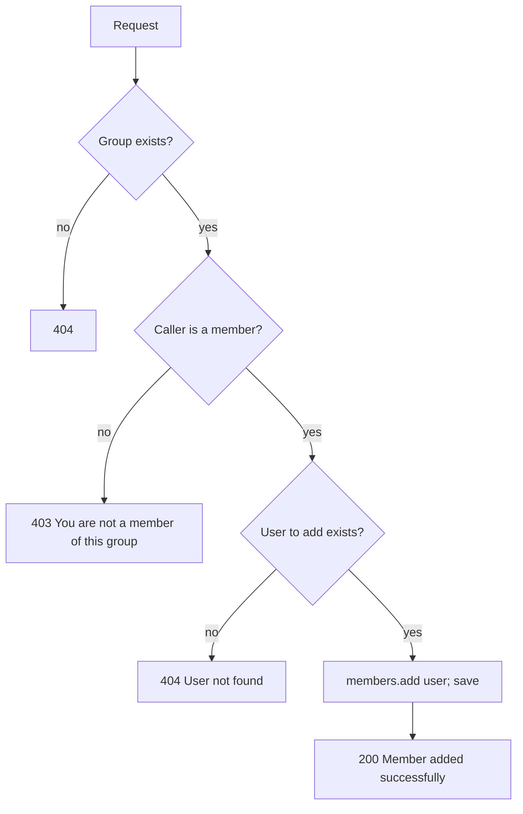
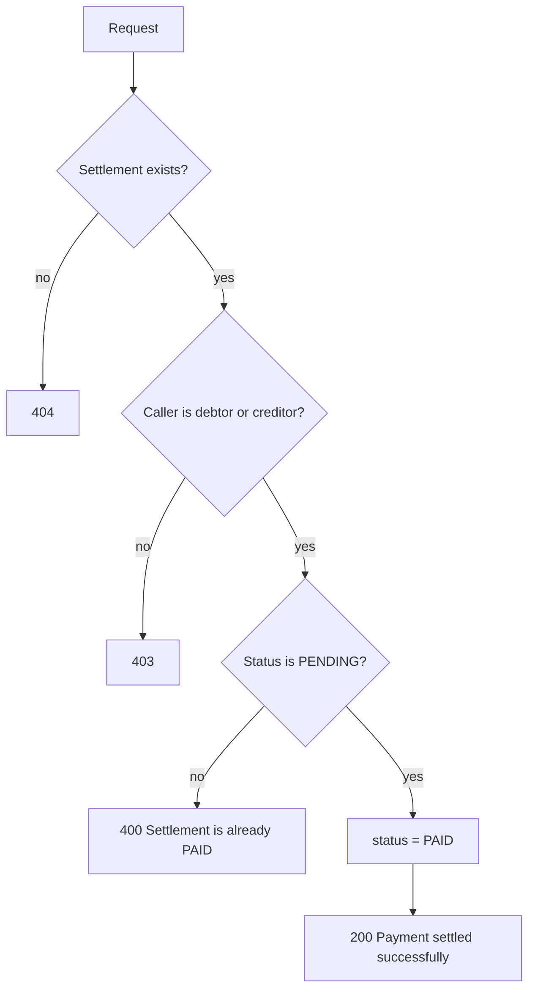

# Flows

Every business flow in the backend, in the order a user meets them: what is checked, what is written to the database, and what comes back. Request and response fields are in [API_DOCUMENTATION.md](../API_DOCUMENTATION.md); the request pipeline (JWT filter, error handling) is in [ARCHITECTURE.md](ARCHITECTURE.md#request-lifecycle).

"Caller" below means the user identified by the request's JWT.

## Contents

1. [Register](#1-register)
2. [Login](#2-login)
3. [Profile and user lookup](#3-profile-and-user-lookup)
4. [Create a group](#4-create-a-group)
5. [Add a member](#5-add-a-member)
6. [View groups](#6-view-groups)
7. [Add an expense](#7-add-an-expense)
8. [View expenses](#8-view-expenses)
9. [Delete an expense](#9-delete-an-expense)
10. [Balances and settlement generation](#10-balances-and-settlement-generation)
11. [Pending settlements](#11-pending-settlements)
12. [Pay a settlement](#12-pay-a-settlement)
13. [Group summary](#13-group-summary)
14. [Worked example](#14-worked-example)

---

## 1. Register

`POST /api/auth/register` · public

```mermaid
sequenceDiagram
    actor U as Client
    participant AC as AuthController
    participant US as UserService
    participant DB as Postgres
    participant JWT as JwtTokenProvider

    U->>AC: name, email, password, phone?
    AC->>AC: validate (name, email, password required; email format; phone ≤ 20)
    AC->>US: registerUser
    US->>DB: existsByEmail
    alt email taken
        US-->>AC: "Email already registered"
        AC-->>U: 400
    end
    US->>US: BCrypt-hash password; blank phone → null
    US->>DB: INSERT users
    AC->>JWT: generateTokenFromEmail
    AC-->>U: 201 {token, type: Bearer, userId, email, name}
```

- The user is logged in straight away: the response carries a token.
- **Writes:** one `users` row.

## 2. Login

`POST /api/auth/login` · public

1. `AuthenticationManager` → `DaoAuthenticationProvider` loads the user by email (`CustomUserDetailsService`) and checks the password with BCrypt.
2. Wrong password or unknown email → `BadCredentialsException` → `401 "Invalid credentials"`. The message is the same for both, so it doesn't reveal which emails exist.
3. Success → a new HS512 token with `sub` = email, valid for `JWT_EXPIRATION` ms → `200 {token, type, userId, email, name}`.

The client sends the token as `Authorization: Bearer <token>` on every later request. There is no logout endpoint: the client just discards the token, which stays valid until it expires.

## 3. Profile and user lookup

| Endpoint | Flow |
|---|---|
| `GET /api/users/profile` | Returns the caller's own `UserDTO` |
| `GET /api/users/{userId}` | Returns any user's `UserDTO` (name, email, phone); `404` if unknown. Used by the app to show who someone is before adding them |

`UserDTO` never includes the password.

## 4. Create a group

`POST /api/groups` · any logged-in user

1. Validate: `name` required.
2. Load the caller; they become `created_by` **and** the first member.
3. Each ID in `memberIds` (optional) must exist, otherwise `400 "User not found with id: …"` and nothing is saved.
4. **Writes:** one `groups` row and one `group_members` row per member, including the caller.
5. `201` with the `GroupDTO`.

## 5. Add a member

`POST /api/groups/{groupId}/members/{userId}` · group members only



- Adding someone who is already a member is a no-op: members are a `Set`, and `group_members` has a composite primary key.
- Adding a member doesn't recalculate settlements. A new member starts at a zero balance and only shares expenses added from then on.

## 6. View groups

| Endpoint | Access | Flow |
|---|---|---|
| `GET /api/groups/user/groups` | caller | Every group the caller is a member of (JPQL join on `members`) |
| `GET /api/groups/{groupId}` | members | `requireMember`, then the `GroupDTO` with all members; `404` if no such group, `403` if not a member |

## 7. Add an expense

`POST /api/expenses` · group members only. This is the central flow: it writes the expense, its splits, regenerates the group's settlements, and triggers notifications.

```mermaid
sequenceDiagram
    actor U as Caller (payer)
    participant EC as ExpenseController
    participant ES as ExpenseService
    participant GS as GroupService
    participant SC as SplitCalculatorService
    participant SS as SettlementService
    participant DB as Postgres
    participant L as Notification listener

    U->>EC: groupId, amount, description?, participantIds, splitType?
    EC->>EC: validate (amount ≥ 0.01, ≤ 2 decimals; participantIds not empty)
    EC->>ES: createExpense(request, callerId)
    ES->>GS: requireMember(groupId, callerId)
    Note over ES: 404 no group · 403 caller not a member
    ES->>ES: splitType null → EQUAL; anything else → 400
    loop each participantId
        ES->>DB: user exists? (400 if not)
        ES->>GS: isMember? (400 if not)
    end
    ES->>DB: INSERT expenses + expense_participants
    ES->>SC: equalSplit(amount, participants)
    ES->>DB: INSERT expense_splits
    ES->>SS: generateSettlements(group)
    SS->>DB: DELETE pending settlements, INSERT new ones
    ES->>ES: publish ExpenseCreatedEvent
    ES-->>EC: expense
    EC-->>U: 201 ExpenseDTO
    Note over DB,L: after commit, on a background thread
    L-->>L: notify every member except the payer
```

**Rules**
- The **payer is always the caller.** There's no way to record an expense someone else paid.
- The payer doesn't have to be a participant. If Alice pays for Bob and Carol only, she's owed the full amount.
- Participants must all be group members, and duplicates collapse (a `Set`).
- Everything runs in one transaction: if any step fails, nothing is saved and no notification is sent.

**Equal split** (`SplitCalculatorService.equalSplit`)
1. `share = amount ÷ n`, rounded **down** to 2 decimals.
2. `leftover = amount − share × n` (between 0 and n−1 paise).
3. Sort participants by user ID; the first `leftover` of them get `share + 0.01`.

₹100 split 3 ways → 33.34, 33.33, 33.33. The splits always add up to the amount exactly, and who gets the extra paisa is deterministic.

**Writes:** `expenses` (1), `expense_participants` (n), `expense_splits` (n), and `settlements` (pending ones replaced, see [§10](#10-balances-and-settlement-generation)).

## 8. View expenses

| Endpoint | Access | Flow |
|---|---|---|
| `GET /api/expenses/group/{groupId}` | members | `requireMember`, then every expense in the group with payer, participants and splits |
| `GET /api/expenses/{expenseId}` | members of the expense's group | Load the expense (`404` if unknown), then `requireMember` on its group (`403`) |

## 9. Delete an expense

`DELETE /api/expenses/{expenseId}` · the payer only

1. Load the expense: `404` if unknown.
2. The caller must be the payer: `403 "Only the person who paid can delete this expense"`.
3. Delete it: splits go by JPA cascade, participants by `ON DELETE CASCADE`.
4. `generateSettlements(group)` recomputes pending settlements without it.

PAID settlements are kept. If a debt was already paid and the expense behind it is then deleted, the recomputed balances show the money flowing back: the old creditor now owes the old debtor. That's intentional, because the payment really happened.

## 10. Balances and settlement generation

Runs inside every expense add or delete (`SettlementService.generateSettlements`). Settlements are never edited one by one: pending ones are thrown away and rebuilt from the full history.

**Step 1 — balances** (`calculateBalances`). Every member starts at 0. A positive balance means the group owes them money; negative means they owe.

| Source | Effect |
|---|---|
| each expense | payer `+ amount` |
| each split | split user `− split amount` |
| each **PAID** settlement | debtor `+ amount`, creditor `− amount` (money already handed over) |

Balances always add up to zero.

**Step 2 — replace pending settlements.** Delete every `PENDING` settlement in the group; keep `PAID` ones.

**Step 3 — greedy matching.**

```
for each member D with balance < 0:          # debtor
    owe = −balance(D)
    for each other member C with balance > 0: # creditor
        pay = min(owe, balance(C))
        create PENDING settlement D → C for pay
        balance(C) −= pay ; owe −= pay
        stop when owe == 0
```

Members are visited in `HashMap` order, so with several creditors, which debtor pays which creditor can change between recalculations. The total each person owes or is owed is always correct. The result isn't minimised: it can create more transfers than strictly needed.

## 11. Pending settlements

`GET /api/settlements/group/{groupId}/user/pending` · group members only

Returns the caller's `PENDING` settlements in the group from both sides: the ones where they are the debtor (they owe) and the ones where they are the creditor (they are owed). The app's "You are owed ₹250" card comes from this.

## 12. Pay a settlement

`POST /api/settlements/{settlementId}/pay` · the debtor or the creditor



- No money moves; this only records that the payment happened outside the app.
- Either party can record it: the debtor ("I paid") or the creditor ("I received it").
- The row becomes permanent history and counts in every later balance calculation, so the debt never comes back ([§10](#10-balances-and-settlement-generation)).
- Paying doesn't trigger a recalculation by itself. The other pending settlements are still correct, because the paid amount equals the debt it cleared.

## 13. Group summary

`GET /api/settlements/group/{groupId}/summary` · group members only

Returns, for the whole group:
- `balances`: every member's current net balance (same calculation as [§10](#10-balances-and-settlement-generation), PAID settlements included), sorted by user ID;
- `settlements`: every `PENDING` settlement in the group;
- `groupId`.

Read-only: nothing is recalculated or written.

## 14. Worked example

Alice (id 1), Bob (2) and Carol (3) are in one group.

**Alice pays ₹300 for all three.** Splits 100 / 100 / 100.

| | Alice | Bob | Carol |
|---|---|---|---|
| balance | +200.00 | −100.00 | −100.00 |

Pending: Bob → Alice 100.00, Carol → Alice 100.00.

**Bob pays ₹100 for all three.** 100 ÷ 3 = 33.33 with 1 paisa left over, so Alice (the lowest ID) gets 33.34.

| | Alice | Bob | Carol |
|---|---|---|---|
| expense 1 | +300 − 100 | −100 | −100 |
| expense 2 | −33.34 | +100 − 33.33 | −33.33 |
| **balance** | **+166.66** | **−33.33** | **−133.33** |

Old pending settlements are deleted. New ones: Bob → Alice 33.33, Carol → Alice 133.33.

**Bob marks his 33.33 paid.** Status becomes PAID; nothing else changes.

**Carol pays ₹30 for all three.** Splits 10 / 10 / 10. The recalculation now includes the PAID row:

| | Alice | Bob | Carol |
|---|---|---|---|
| expenses 1–3 | +156.66 | −43.33 | −113.33 |
| PAID Bob → Alice | −33.33 | +33.33 | |
| **balance** | **+123.33** | **−10.00** | **−113.33** |

New pending: Bob → Alice 10.00, Carol → Alice 113.33. Bob owes only his share of the snacks, and the debt he already paid isn't counted again.

**Group summary at this point:** balances `[1: 123.33, 2: −10.00, 3: −113.33]`, plus those two pending settlements.

**Alice deletes the ₹300 expense.** She's the payer, so it's allowed. Recalculated without it: Alice −33.34 − 10 − 33.33 (PAID) = −76.67, Bob +100 − 33.33 − 10 + 33.33 = +90.00, Carol −33.33 + 30 − 10 = −13.33. Alice now owes Bob 76.67, and Carol owes Bob 13.33.
